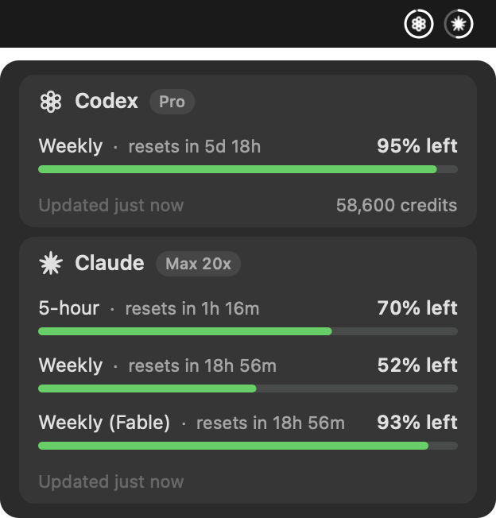

<div align="center">

# AICreditsBar

**How much of your Codex and Claude plan limits is left — in the macOS menu bar.**




**[English](#english) · [한국어](#한국어)**

</div>

---

## English

A small native menu-bar app. Each provider's mark sits in a thin ring that fills with the
remaining % of the limit you'll hit first. Hover for the exact numbers; click for every
limit, its reset countdown, and your plan.

### Where the numbers come from

| Provider | Source | Signed in with |
|---|---|---|
| **Codex** | `chatgpt.com/backend-api/wham/usage` | your Codex CLI login (`~/.codex/auth.json`) |
| **Claude** | `api.anthropic.com/api/oauth/usage` | your Claude Code login (macOS Keychain) |

These are the official usage endpoints — the same numbers as Codex's `/status` and
Claude Code's `/usage`. Nothing is estimated:

- Each plan limit is shown as the provider reports it. Codex windows are named by their real
  length (a Pro plan currently has a single 7-day window, so there is no 5-hour row).
  Claude's per-model weekly limits (e.g. *Weekly (Fable)*) get their own row. Codex's separate
  code-review limit isn't shown.
- If a refresh fails, the last reading stays visible but greyed, with its age and the reason.
- A window whose reset time has passed shows **—** until the next reading. It is never
  assumed to be back at 100%.
- Not signed in, or a login expired? The menu says so and shows no numbers.

### The menu bar

- One ring per provider. It shows the **lowest remaining** limit by default (Settings can
  pin it to the 5-hour or weekly window). Per-model limits are left out of the ring.
- Drawn in the menu bar's own text color while healthy, **orange** below 30 %, **red**
  below 10 %, faded when the reading isn't current. Thresholds are adjustable.
- Checks every 5 minutes, when the menu opens (at most every 2 minutes), and after the Mac
  wakes. The usage endpoints rate-limit hard — Anthropic's especially — so a service that
  answers HTTP 429 is left alone for 5, 10, 20, then 30 minutes.
- The last good reading is saved, so after a restart it shows right away (faded, with its
  age) until a fresh one arrives.
- Countdown labels redraw only when their displayed value changes. A closed menu has
  no per-second timer; unchanged ring images are reused. Changing display settings
  does not make extra usage requests, and disabling both providers stops polling.

### Notifications

In **Settings → Notifications**, choose **Enable Notifications** once to grant macOS
permission. Each enabled provider's limits, including model-specific limits, can alert:

- **20% remaining or less:** one warning per observed quota window, remembered across
  app restarts. The threshold uses the reported value before display rounding.
- **Quota recovered:** a fresh successful response shows lower usage in a new reset
  window, or an exhausted limit becomes available again. Time passing alone, an old
  snapshot, or a failed request never announces recovery.

The checks use the same automatic refresh interval and backoff as the menu; these are
not instantaneous server push notifications. The two alert types can be switched off
independently. **Test Alerts** sends clearly labeled sample notifications through the
same detector and macOS delivery service, then checks Notification Center delivery.
It does not consume AI quota or change the real alert history. Focus and macOS
notification settings control whether banners appear. Alerts are silent.

If an endpoint omits reset times, a full refill from exhausted to zero usage starts a
new warning cycle. Ordinary percentage fluctuations do not repeatedly warn.
Delayed responses cannot overwrite newer notification history. Temporarily omitted
limits retain their history until reset (24 hours without a reset time), with up to
32 omitted limits per provider retained to keep storage bounded.

### Requirements

- macOS 11 or later, Intel or Apple Silicon.
- Xcode Command Line Tools for `swiftc` (`xcode-select --install`).
- The Codex CLI and/or Claude Code, signed in with a ChatGPT / Claude plan.

### Build & run

```bash
bash build.sh          # compile Sources/*.swift → AICreditsBar.app
open AICreditsBar.app  # menu-bar only, no Dock icon
```

Start at login: `bash scripts/install-login-item.sh` (remove with `-u`); it also brings the
app back if it ever crashes. macOS ties a login item to the exact ad-hoc-signed build, so
`build.sh` re-registers it — and restarts the app — after every rebuild.

### Command line

```bash
B=./AICreditsBar.app/Contents/MacOS/aicreditsbar
$B --once                     # check every limit now (live requests), print, exit
$B --dump-config              # settings, then the same report
$B --render-preview menu.png  # the menu bar + dropdown as the app last saw them, as a PNG
$B --render-settings out.png  # the Settings window as a PNG
$B --settings                 # open Settings (launches the app if needed)
```

### Privacy

The app reads the two logins above locally and sends each only to its own provider's
usage endpoint. No telemetry, no other servers, no cookies or cache written to disk.
If macOS asks whether it may read "Claude Code-credentials" from the Keychain, choose
**Always Allow** (Claude Code normally stores it in a way that needs no prompt).

### Project structure

```
Sources/
  Codex.swift          Codex login + usage API + parsing
  Claude.swift         Claude Code login + usage API + parsing
  Models.swift         UsageWindow, Reading, ProviderState
  Support.swift        formatting, JSON, HTTP and Keychain helpers
  RefreshController.swift  background checks, one request per provider at a time
  DisplaySchedule.swift    redraw only at visible time/status boundaries
  QuotaAlerts.swift        pure quota transition detection and durable deduplication
  NotificationController.swift  macOS permission, delivery and explicit sample test
  AppInstance.swift    process-lifetime lock against simultaneous app launches
  Rendering.swift      menu-bar rings, colors, provider marks
  ProviderCardView.swift   the dropdown cards
  AppDelegate.swift    status item and menu
  Settings.swift       Settings window
  Config.swift         settings storage
  CLI.swift / Preview.swift / main.swift
Tests/                 unit + end-to-end tests: bash Tests/run.sh
scripts/               install-login-item.sh
```

`bash Tests/run.sh` builds throwaway binaries, runs the unit tests (including real API
replies as fixtures) and an end-to-end pass in a scratch `HOME` with no Keychain access. It
never touches the installed app or your settings.
Regression coverage includes notification thresholds/restarts/delivery retries,
out-of-order permission callbacks and responses, temporarily omitted limits,
10,100 simulated readings, HTTP cancellation, offline/TLS errors, per-provider backoff,
display scheduling, process locking, and checkout-specific restart behavior.

To sample a running app's CPU time, memory footprint, wakeups and disk counters:
`python3 Tests/measure_resources.py <PID> --seconds 60 --output report.json`.
For a one-hour run, use `--seconds 3600 --interval 15`. The report records memory
growth and a sample timeline, updates every minute, and reports an interrupted
process as an incomplete measurement.
The elapsed clock excludes deep sleep on macOS; the report also records UTC
wall-clock duration, so a one-hour measurement can take longer if the Mac sleeps.
CPU counters are converted with the host's Mach timebase (important on Apple
Silicon). `Tests/test_resources.py` checks this against an independent process CPU
clock and is included in `Tests/run.sh`.
This does not measure battery life or GPU work performed by WindowServer.
See the [2026-10-22 validation record](docs/validation-2026-10-22.json) for the tested
environment, live-app checks, resource samples and remaining limits.
Its CPU values were corrected on 2026-10-23 to apply the Apple Silicon Mach timebase;
the record preserves the previous values and the calibration evidence.
The [one-hour follow-up](docs/validation-2026-10-23.json) and
[resource chart](docs/validation-2026-10-23.svg) record 60 minutes of awake-time
measurement, 13 automatic refreshes per provider, observed sleep recovery, and
the remaining OS diagnostics and measurement limits.

### License

MIT — see [LICENSE](LICENSE).

---

## 한국어

Codex와 Claude 요금제 한도가 얼마나 남았는지 macOS 메뉴바에 보여주는 작은 네이티브 앱입니다.
각 서비스 아이콘을 감싼 얇은 링이 **가장 먼저 닿을 한도의 남은 %** 만큼 채워집니다. 마우스를
올리면 정확한 숫자, 클릭하면 모든 한도와 리셋까지 남은 시간, 요금제를 보여줍니다.

### 숫자의 출처

| 서비스 | 출처 | 로그인 |
|---|---|---|
| **Codex** | `chatgpt.com/backend-api/wham/usage` | Codex CLI 로그인 (`~/.codex/auth.json`) |
| **Claude** | `api.anthropic.com/api/oauth/usage` | Claude Code 로그인 (macOS 키체인) |

두 서비스의 공식 사용량 API이며, Codex의 `/status`, Claude Code의 `/usage`와 같은 숫자입니다.
추정치는 없습니다.

- 요금제 한도는 서비스가 보고한 그대로 표시합니다. Codex 창 이름은 실제 길이로 정합니다
  (현재 Pro 요금제는 7일 창 하나뿐이라 5시간 줄이 없습니다). Claude의 모델별 주간 한도
  (예: *Weekly (Fable)*)는 별도 줄로 보여줍니다. Codex의 별도 코드리뷰 한도는 표시하지 않습니다.
- 갱신에 실패하면 마지막 값을 회색으로 남기고, 몇 분 전 값인지와 실패 이유를 표시합니다.
- 리셋 시각이 지난 창은 새 값을 받을 때까지 **—** 로 표시합니다. 100%로 가정하지 않습니다.
- 로그인이 없거나 만료되면 그렇게 알려주고 숫자는 표시하지 않습니다.

### 메뉴바

- 서비스마다 링 하나. 기본값은 **가장 적게 남은 한도**이며, 설정에서 5시간/주간 창으로
  고정할 수 있습니다. 모델별 한도는 링에서 제외합니다.
- 여유가 있으면 메뉴바 글자색, 30% 미만 **주황**, 10% 미만 **빨강**, 최신 값이 아니면 흐리게.
  기준값은 설정에서 바꿀 수 있습니다.
- 5분마다, 메뉴를 열 때(최대 2분에 한 번), 잠자기에서 깨어날 때 확인합니다. 사용량 API는
  호출 제한이 엄격해서(특히 Anthropic) HTTP 429를 받으면 그 서비스는 5→10→20→30분 쉽니다.
- 마지막 정상 값을 저장해 두어, 재시작 직후에도 (흐리게, 몇 분 전 값인지와 함께) 바로 보여줍니다.
- 카운트다운은 표시 내용이 바뀔 때만 다시 그립니다. 메뉴가 닫혀 있으면 매초 실행되는 타이머가
  없고, 값이 그대로인 링 이미지도 재사용합니다. 표시 설정 변경으로 API를 추가 호출하지 않으며,
  두 서비스를 모두 끄면 자동 조회도 멈춥니다.

### 알림

**Settings → Notifications → Enable Notifications**에서 macOS 알림을 허용하세요.
켜 둔 서비스의 각 한도(모델별 한도 포함)를 대상으로 두 종류의 알림을 제공합니다.

- **잔여 20% 이하:** 관측한 한도 창마다 한 번 알립니다. 이력은 앱을 재시작해도 유지하며,
  화면에 반올림한 숫자가 아닌 원래 응답 값으로 판단합니다.
- **한도 회복:** 새 조회에서 리셋 이후 사용량 감소가 확인되거나, 소진됐던 한도를 다시 쓸 수
  있게 된 경우 알립니다. 시간 경과·저장된 과거 값·조회 실패만으로 회복됐다고 알리지 않습니다.

메뉴와 같은 자동 조회 주기와 호출 제한 대기를 사용하므로 서버의 실시간 푸시 알림은 아닙니다.
알림 종류별로 끌 수 있으며 소리는 재생하지 않습니다. **Test Alerts**는 샘플이라고 표시된
데이터로 두 알림을 실제 macOS에 보내고 알림 센터 도착 여부를 확인합니다. 실제 AI 한도나
알림 이력은 바꾸지 않습니다. 배너 표시는 집중 모드와 macOS 알림 설정에 따릅니다.

API에 리셋 시각이 없으면 완전히 소진된 한도가 사용량 0으로 충전됐을 때 다음 경고 주기를
시작합니다. 잔량이 조금 오르내리는 것만으로 경고를 반복하지 않습니다.
늦게 도착한 응답은 최신 알림 이력을 덮어쓰지 않습니다. API에서 일시적으로 빠진 한도도
리셋 시각까지(리셋 시각이 없으면 24시간) 이력을 유지하며, 저장량을 제한하기 위해 서비스별
최대 32개의 누락된 한도를 보관합니다.

### 요구 사항

- macOS 11 이상 (Intel / Apple Silicon).
- `swiftc`용 Xcode Command Line Tools (`xcode-select --install`).
- ChatGPT/Claude 요금제로 로그인한 Codex CLI 또는 Claude Code.

### 빌드 & 실행

```bash
bash build.sh          # Sources/*.swift 컴파일 → AICreditsBar.app
open AICreditsBar.app  # 메뉴바 전용 (Dock 아이콘 없음)
```

로그인 시 자동 실행: `bash scripts/install-login-item.sh` (제거는 `-u`, 앱이 비정상 종료되면 다시 띄움). macOS는 로그인 항목을
등록 당시의 ad-hoc 서명 빌드에 묶어두기 때문에, `build.sh`가 재빌드 후 다시 등록하고 앱을
재시작합니다.

### 커맨드라인

```bash
B=./AICreditsBar.app/Contents/MacOS/aicreditsbar
$B --once                     # 모든 한도를 지금 조회(실제 요청)해 출력하고 종료
$B --dump-config              # 설정 출력 후 같은 보고
$B --render-preview menu.png  # 앱이 마지막으로 받은 값으로 메뉴바 + 드롭다운을 PNG 렌더
$B --render-settings out.png  # 설정 창을 PNG로 렌더
$B --settings                 # 설정 창 열기 (필요하면 앱 실행)
```

### 개인정보

위 두 로그인 정보를 로컬에서 읽어 각 서비스의 사용량 API에만 보냅니다. 텔레메트리, 다른 서버,
디스크에 쓰는 쿠키·캐시가 없습니다. macOS가 키체인의 "Claude Code-credentials" 접근을 물으면
**항상 허용**을 선택하세요 (보통 Claude Code가 묻지 않아도 되게 저장합니다).

### 테스트

`bash Tests/run.sh` — 임시 바이너리를 빌드해 단위 테스트(실제 API 응답을 픽스처로 사용)와
e2e(키체인 접근 없는 임시 `HOME`)를 실행합니다. 설치된 앱과 설정은 건드리지 않습니다.
알림 경계값·재시작·재시도, 10,100회 연속 입력, HTTP 취소·연결 실패, 서비스별 재시도 대기,
권한 콜백·응답의 순서 역전, 한도 일시 누락, 화면 갱신 시점, 중복 실행 방지와 다른 경로의
앱을 보존하는 재시작을 검사합니다.

`python3 Tests/measure_resources.py <PID> --seconds 60 --output report.json`으로 실행 중인
앱의 CPU 시간·메모리·웨이크업·디스크 카운터를 측정할 수 있습니다. 이 스크립트로 배터리
지속 시간이나 WindowServer가 수행한 GPU 작업을 측정할 수는 없습니다.
1시간 측정에는 `--seconds 3600 --interval 15`를 사용합니다. 보고서는 메모리 변화와
시점별 표본을 포함하고 매분 저장되며, 프로세스가 종료되면 미완료로 기록합니다.
macOS에서는 잠자기 시간이 측정 시간에서 제외되므로 Mac이 잠들면 완료까지 더 오래 걸릴 수
있습니다. 잠자기를 포함한 실제 경과 시간도 UTC 시각과 함께 별도로 기록합니다.
CPU 카운터는 Mac의 Mach 시계 단위를 적용해 초로 환산합니다. Apple Silicon에서 이 환산이
누락되지 않도록 별도의 프로세스 CPU 시계와 비교하는 검증도 `Tests/run.sh`에 포함했습니다.
[2026-10-22 검증 기록](docs/validation-2026-10-22.json)에 환경·실제 앱 확인·성능 표본과
검증하지 못한 범위를 남겼습니다.
해당 기록의 CPU 수치는 2026-10-23에 Apple Silicon의 Mach 시계 환산을 적용해 정정했으며,
이전 값과 환산 검증 근거도 함께 보관했습니다.
[1시간 후속 검증](docs/validation-2026-10-23.json)과
[자원 사용 그래프](docs/validation-2026-10-23.svg)에는 잠자기를 제외한 60분 측정,
서비스별 13회 자동 갱신, 잠자기 이후 조회 재개, 남아 있는 OS 진단 메시지와 측정 한계를
기록했습니다.

### 라이선스

MIT — [LICENSE](LICENSE) 참고.
