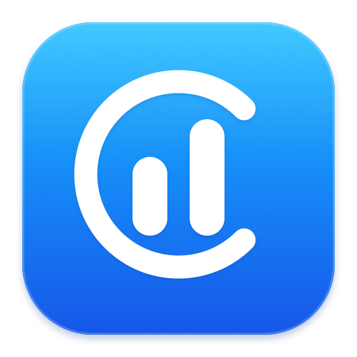
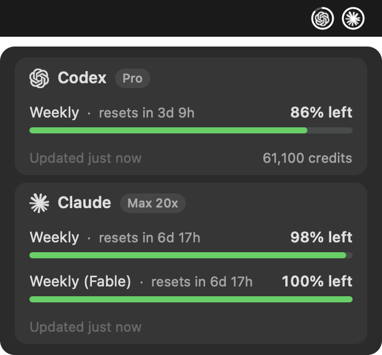

<div align="center">

# AICreditsBar



**How much of your Codex and Claude plan limits is left — in the macOS menu bar.**


https://github.com/user-attachments/assets/994acdf9-8a57-48b1-a5b2-71e3c6f1077f



**[English](#english) · [한국어](#한국어)**

</div>

---

## English

A small native menu-bar app. Each provider's mark sits in a thin ring that fills with the
remaining % of the limit you'll hit first. Hover for the exact numbers; click for every
limit, its reset countdown, and your plan.

### Where the numbers come from

| Provider | Source | Signed in with |
|---|---|---|
| **Codex** | `chatgpt.com/backend-api/wham/usage` | your Codex CLI login (`~/.codex/auth.json`) |
| **Claude** | `api.anthropic.com/api/oauth/usage` | your Claude Code login (macOS Keychain) |

These are the internal usage endpoints that Codex and Claude Code themselves call — the same
numbers as Codex's `/status` and Claude Code's `/usage`. They are not documented public APIs
and may change without notice. The numbers are never estimated (the separate, labeled
[forecast](#forecast-and-model-advice) is the only estimate):

- Each plan limit is shown as the provider reports it. Codex windows are named by their real
  length (a Pro plan currently has a single 7-day window, so there is no 5-hour row).
  Claude's per-model weekly limits (e.g. *Weekly (Fable)*) get their own row. Codex's separate
  code-review limit isn't shown.
- If a refresh fails, the last reading stays visible but greyed, with its age and the reason.
- A window whose reset time has passed shows **—** until the next reading. It is never
  assumed to be back at 100%.
- Not signed in? The menu says so and shows no numbers.
- Claude Code renews its login token only while it is running, so someone who works in the desktop
  app or an editor can be signed in with a stored token that expired hours ago. When that happens the
  app starts the official `claude` CLI once, headless, so it renews and stores its own token: nothing
  is sent to the model, no session is saved, the app never reads or uses the refresh token, and it
  tries at most every 15 minutes. If that doesn't work the menu says the login expired. Each attempt is
  written as one line to `~/Library/Application Support/AICreditsBar/login-renewal.log`, so you can see
  afterwards whether it really renewed.

### The menu bar

- One ring per provider. It shows the **lowest remaining** limit by default (Settings can
  pin it to the 5-hour or weekly window). Per-model limits are left out of the ring.
- Drawn in the menu bar's own text color while healthy, **orange** below 30 %, **red**
  below 10 %, faded when the reading isn't current. Thresholds are adjustable.
- Checks every 3 minutes, when the menu opens (at most every 2 minutes), and after the Mac
  wakes. The usage endpoints rate-limit hard — Anthropic's especially — so a service that
  answers HTTP 429 is left alone for 5, 10, 20, then 30 minutes.
- The last good reading is saved, so after a restart it shows right away (faded, with its
  age) until a fresh one arrives.
- Countdown labels redraw only when their displayed value changes. A closed menu has
  no per-second timer; unchanged ring images are reused. Changing display settings
  does not make extra usage requests, and disabling both providers stops polling.

### Forecast and model advice

Below each provider's limits the menu adds a block labeled **FORECAST · ESTIMATE**. It is
computed on your Mac and never changes the numbers above it. It is hidden when the reading
isn't current, and **Settings → Forecast** turns it off.

- **Pace.** Each limit says whether you are *on track* (and how much is left at the reset)
  or *ends ≈2d 10h early (at avg pace)* — the average includes the hours you don't use it.
- **Per-model estimate (Claude).** Claude Code records every message's model and tokens in
  `~/.claude/projects` on this Mac. The app prices those tokens at the published API rates,
  matches the total to the percentage Claude reports for the same cycle (so it learns how
  much of *your* limit one dollar of work uses), then reprices the same tokens as if Haiku,
  Sonnet or Opus had done all of it. Each model gets its pace in %/day and the hours of
  active use the remaining % lasts.
- **Advice.** The strongest model whose pace fits what you can spend per day (remaining % ÷
  days left, with a 15% margin): *Opus 5.5 is fine today*, *Stay on Sonnet 5.5*, *Use Haiku 5.5
  from now on*, or *Go easy — even Haiku 5.5 runs short*. "Stay" and "from now on" are
  relative to the model that did most of your recent work.
- **No guessing.** Until a day of the week has passed, or without Claude Code history on this
  Mac, the advice and per-model rows say *not enough data yet*.
- **Limit resets.** If the limit is reset mid-cycle (a reset coupon: 98% → 0% with the same reset
  time), the app sees the figure fall and carries the use before it over: the pace, the tokens-to-%
  ratio and the per-model numbers keep counting the whole cycle, as if the counter had never been
  reset, and the card says a reset was noticed. A reset that happens while the app is closed is
  noticed at the next reading. The 20% warning is armed again too.

Limits: it assumes plan limits follow token prices (calibrated to your own usage, but not
published by Anthropic); Claude Code use on other devices or in claude.ai counts toward the
percentage but isn't in the local history; Haiku 5.5's newer tokenizer isn't adjusted for.
The history is read locally, only what was added since the last read, and never sent
anywhere. **Settings → Forecast** can turn the comparison off and forgets what was read.

**Checked against what happened.** The app keeps the readings it gets (one per 15 minutes,
a week at most, on this Mac) and, as time passes, compares its earlier forecasts with the
readings that followed. The card shows two lines once there are at least 3 checks of each:

- *24h pace: off by 3.1 pts · 12 checks* — the used % it predicted a day ahead from the
  cycle's average pace, against the used % Claude/Codex then reported (it says *ran high* or
  *ran low* when it was consistently off one way).
- *Model costs: real burn ×1.08 of priced* — the % the priced Claude Code tokens predicted for the
  next 6 hours, against the % actually used. ×1.00 means limits really are used up in
  proportion to API prices; below 1 means the priced tokens over-predicted, above 1 under.
  This tests the one assumption the per-model numbers rest on.

Until then it says *Accuracy check: not enough data yet*. Both start from the app's first
reading, so the cost check has its first numbers after about 9 hours and the pace check after
about a day (a cycle must also be at least a day old).

### Notifications

In **Settings → Notifications**, choose **Enable Notifications** once to grant macOS
permission. Each enabled provider's limits, including model-specific limits, can alert:

- **20% remaining or less:** one warning per observed quota window, remembered across
  app restarts. The threshold uses the reported value before display rounding.
- **Quota recovered:** a fresh successful response shows lower usage in a new reset
  window, or an exhausted limit becomes available again. Time passing alone, an old
  snapshot, or a failed request never announces recovery.

The checks use the same automatic refresh interval and backoff as the menu; these are
not instantaneous server push notifications. The two alert types can be switched off
independently. **Test Alerts** sends clearly labeled sample notifications through the
same detector and macOS delivery service, then checks Notification Center delivery.
It does not consume AI quota or change the real alert history. Focus and macOS
notification settings control whether banners appear. Alerts are silent.

If an endpoint omits reset times, a full refill from exhausted to zero usage starts a
new warning cycle. Ordinary percentage fluctuations do not repeatedly warn.
Delayed responses cannot overwrite newer notification history. Temporarily omitted
limits retain their history until reset (24 hours without a reset time), with up to
32 omitted limits per provider retained to keep storage bounded.

### Requirements

- macOS 11 or later, Intel or Apple Silicon.
- Xcode Command Line Tools for `swiftc` (`xcode-select --install`).
- The Codex CLI and/or Claude Code, signed in with a ChatGPT / Claude plan.

### Build & run

```bash
bash build.sh          # compile Sources/*.swift → AICreditsBar.app
open AICreditsBar.app  # menu-bar only, no Dock icon
```

The app bundle includes an icon for Finder and macOS notifications. To edit its
original vector geometry, change `scripts/render-app-icon.swift` and run
`bash scripts/build-app-icon.sh` before rebuilding. The generated ICNS contains
16–1024 pixel representations and is checked in, so normal builds need no extra tools.

The build uses your Apple Development or Developer ID Application signing identity
when exactly one is available. Choose a specific identity with `AICB_SIGN_IDENTITY`
(certificate name or hash), or set it to `-` to force ad-hoc signing. With no certificate
or multiple candidates it falls back to ad hoc. On the tested macOS 27.0 build, an ad-hoc build logs
App Intents connection errors because it has no Team ID; quota polling still works.
Signing is local and does not notarize or publish the app.

Start at login: `bash scripts/install-login-item.sh` (remove with `-u`); it also brings the
app back if it ever crashes. `build.sh` re-registers the login item and restarts the app
after every rebuild so it uses the newly signed binary.

### Updates

Once a day the app asks GitHub for this repository's latest release. When a newer version
is out, the menu and **Settings → Updates** offer **Update to X and Restart**: the app
downloads `AICreditsBar.zip`, installs it only if it is that version and signed by the
developer's certificate, replaces itself in place and restarts. **Check for Updates** in
Settings checks right away, and the checkbox there turns the daily check off. A copy whose
Settings has no Updates section was built before updates existed; run
`git pull && bash build.sh` once.

The zip on the Releases page is for these in-app updates. It is not notarized, so macOS
blocks it when opened straight from a browser download; install from source as above.

To publish a release: raise `VERSION`, run `bash scripts/release.sh` with the developer's
certificate, then upload `dist/AICreditsBar.zip` to a GitHub release tagged `v<VERSION>`.

### Command line

```bash
B=./AICreditsBar.app/Contents/MacOS/aicreditsbar
$B --once                     # check every limit now (live requests), print, exit
$B --dump-config              # settings, then the same report
$B --render-preview menu.png  # the menu bar + dropdown as the app last saw them, as a PNG
$B --render-settings out.png  # the Settings window as a PNG
$B --settings                 # open Settings (launches the app if needed)
```

### Privacy

The app reads the two logins above locally and sends each only to its own provider's
usage endpoint. The only other request is the daily update check, which asks GitHub for
this repository's latest release and sends nothing about you. The forecast reads Claude
Code's history in `~/.claude/projects` and saves only token counts per model and 15 minutes
in `~/Library/Application Support/AICreditsBar`; neither leaves this Mac. No telemetry, no
cookies.
If macOS asks whether it may read "Claude Code-credentials" from the Keychain, choose
**Always Allow** (Claude Code normally stores it in a way that needs no prompt).

### Project structure

```
Sources/
  Codex.swift          Codex login + usage API + parsing
  Claude.swift         Claude Code login + usage API + parsing
  Models.swift         UsageWindow, Reading, ProviderState
  Support.swift        formatting, JSON, HTTP and Keychain helpers
  RefreshController.swift  background checks, one request per provider at a time
  DisplaySchedule.swift    redraw only at visible time/status boundaries
  QuotaAlerts.swift        pure quota transition detection and durable deduplication
  NotificationController.swift  macOS permission, delivery and explicit sample test
  AppInstance.swift    process-lifetime lock against simultaneous app launches
  Rendering.swift      menu-bar rings, colors, provider marks
  ProviderCardView.swift   the dropdown cards
  AppDelegate.swift    status item and menu
  Settings.swift       Settings window
  Config.swift         settings storage
  CLI.swift / Preview.swift / main.swift
Tests/                 unit + end-to-end tests: bash Tests/run.sh
scripts/               install-login-item.sh
```

`bash Tests/run.sh` builds throwaway binaries, runs the unit tests (including real API
replies as fixtures) and an end-to-end pass in a scratch `HOME` with no Keychain access. It
never touches the installed app or your settings.
Regression coverage includes notification thresholds/restarts/delivery retries,
out-of-order permission callbacks and responses, temporarily omitted limits,
10,100 simulated readings, HTTP cancellation, offline/TLS errors, per-provider backoff,
display scheduling, process locking, and checkout-specific restart behavior.

In-app updates are tested section by section. The unit tests cover version order, the
release feed, what a check reports, the Settings button, refused downloads and the bundle
swap. `bash Tests/updater/run.sh` covers what needs the developer's Apple Development
certificate: it builds a release from a copy of the checkout, checks `scripts/release.sh`
(version, universal binary, team and timestamp, zip layout, ad-hoc refusal) and that
ad-hoc, tampered, other-app, truncated and misnamed downloads are refused. Without that
certificate it skips.

To sample a running app's CPU time, memory footprint, wakeups and disk counters:
`python3 Tests/measure_resources.py <PID> --seconds 60 --output report.json`.
For a one-hour run, use `--seconds 3600 --interval 15`. The report records memory
growth and a sample timeline, updates every minute, and reports an interrupted
process as an incomplete measurement.
The elapsed clock excludes deep sleep on macOS; the report also records UTC
wall-clock duration, so a one-hour measurement can take longer if the Mac sleeps.
CPU counters are converted with the host's Mach timebase (important on Apple
Silicon). `Tests/test_resources.py` checks this against an independent process CPU
clock and is included in `Tests/run.sh`.
This does not measure battery life or GPU work performed by WindowServer.
See the [2026-10-22 validation record](docs/validation-2026-10-22.json) for the tested
environment, live-app checks, resource samples and remaining limits.
Its CPU values were corrected on 2026-10-23 to apply the Apple Silicon Mach timebase;
the record preserves the previous values and the calibration evidence.
The [one-hour follow-up](docs/validation-2026-10-23.json) and
[resource chart](docs/validation-2026-10-23.svg) record 60 minutes of awake-time
measurement, 13 automatic refreshes per provider, observed sleep recovery, and
the remaining OS diagnostics and measurement limits.

For kernel-attributed task CPU energy and task GPU time, run
`python3 Tests/measure_energy.py <PID> --seconds 900 --output energy.json`.
This compiles a temporary, SDK-typed reader and requires no administrator access.
Add `--require-battery` for an unplugged measurement: it rejects AC power and
reports incomplete coverage if sleep, clock or power-source changes leave gaps.
Battery Wh integrates sampled battery current/voltage for the **whole computer**;
task CPU energy excludes WindowServer and other helpers. Neither is a per-app
battery-life estimate. No measurement tool is bundled into the running app.
See the [diagnostic investigation](docs/diagnostics-2026-10-22.md) for the minimal
AppKit reproduction, measured energy, and issues that remain unresolved.
The [follow-up](docs/diagnostics-2026-10-23.md) records the appearance and signing
fixes, additional independent OS reproductions, and the remaining diagnostic limits.

### License

MIT — see [LICENSE](LICENSE).

---

## 한국어

https://github.com/user-attachments/assets/534aa662-2ca6-4f3b-b360-a8fbff20b511

Codex와 Claude 요금제 한도가 얼마나 남았는지 macOS 메뉴바에 보여주는 작은 네이티브 앱입니다.
각 서비스 아이콘을 감싼 얇은 링이 **가장 먼저 닿을 한도의 남은 %** 만큼 채워집니다. 마우스를
올리면 정확한 숫자, 클릭하면 모든 한도와 리셋까지 남은 시간, 요금제를 보여줍니다.

### 숫자의 출처

| 서비스 | 출처 | 로그인 |
|---|---|---|
| **Codex** | `chatgpt.com/backend-api/wham/usage` | Codex CLI 로그인 (`~/.codex/auth.json`) |
| **Claude** | `api.anthropic.com/api/oauth/usage` | Claude Code 로그인 (macOS 키체인) |

Codex와 Claude Code가 직접 호출하는 내부 사용량 엔드포인트이며, Codex의 `/status`, Claude Code의 `/usage`와 같은 숫자입니다.
공개 문서화된 API가 아니므로 예고 없이 바뀔 수 있습니다.
숫자는 추정하지 않습니다(별도로 표시되는 [예측](#예측과-모델-추천)만 추정치입니다).

- 요금제 한도는 서비스가 보고한 그대로 표시합니다. Codex 창 이름은 실제 길이로 정합니다
  (현재 Pro 요금제는 7일 창 하나뿐이라 5시간 줄이 없습니다). Claude의 모델별 주간 한도
  (예: *Weekly (Fable)*)는 별도 줄로 보여줍니다. Codex의 별도 코드리뷰 한도는 표시하지 않습니다.
- 갱신에 실패하면 마지막 값을 회색으로 남기고, 몇 분 전 값인지와 실패 이유를 표시합니다.
- 리셋 시각이 지난 창은 새 값을 받을 때까지 **—** 로 표시합니다. 100%로 가정하지 않습니다.
- 로그인이 없으면 그렇게 알려주고 숫자는 표시하지 않습니다.
- Claude Code는 실행 중일 때만 로그인 토큰을 갱신합니다. 데스크톱 앱이나 에디터로만 쓰면 로그인은 되어 있는데 저장된 토큰이
  몇 시간 전에 만료되어 있을 수 있습니다. 그럴 때 앱이 공식 `claude` CLI를 화면 없이 한 번 실행해서 CLI가 스스로 토큰을 갱신·저장하게
  합니다. 모델에는 아무것도 보내지 않고, 세션도 저장하지 않으며, 앱은 리프레시 토큰을 읽거나 쓰지 않고, 최대 15분에 한 번만
  시도합니다. 그래도 안 되면 로그인이 만료됐다고 표시합니다. 시도할 때마다
  `~/Library/Application Support/AICreditsBar/login-renewal.log`에 한 줄씩 남겨서, 실제로 갱신됐는지 나중에 확인할 수 있습니다.

### 메뉴바

- 서비스마다 링 하나. 기본값은 **가장 적게 남은 한도**이며, 설정에서 5시간/주간 창으로
  고정할 수 있습니다. 모델별 한도는 링에서 제외합니다.
- 여유가 있으면 메뉴바 글자색, 30% 미만 **주황**, 10% 미만 **빨강**, 최신 값이 아니면 흐리게.
  기준값은 설정에서 바꿀 수 있습니다.
- 3분마다, 메뉴를 열 때(최대 2분에 한 번), 잠자기에서 깨어날 때 확인합니다. 사용량 API는
  호출 제한이 엄격해서(특히 Anthropic) HTTP 429를 받으면 그 서비스는 5→10→20→30분 쉽니다.
- 마지막 정상 값을 저장해 두어, 재시작 직후에도 (흐리게, 몇 분 전 값인지와 함께) 바로 보여줍니다.
- 카운트다운은 표시 내용이 바뀔 때만 다시 그립니다. 메뉴가 닫혀 있으면 매초 실행되는 타이머가
  없고, 값이 그대로인 링 이미지도 재사용합니다. 표시 설정 변경으로 API를 추가 호출하지 않으며,
  두 서비스를 모두 끄면 자동 조회도 멈춥니다.

### 예측과 모델 추천

각 서비스의 한도 아래에 **FORECAST · ESTIMATE**(추정) 블록이 붙습니다. Mac에서 계산하며 위의 숫자를 바꾸지 않습니다.
읽은 값이 최신이 아니면 숨겨지고, **설정 → Forecast**에서 끌 수 있습니다.

- **소진 속도.** 한도마다 *순조로움*(리셋 때 남을 양) 또는 *평균 속도면 리셋보다 ≈2d 10h 일찍 끝남*(안 쓰는 시간까지 포함한 평균입니다)을 알려줍니다.
- **모델별 추정(Claude).** Claude Code는 이 Mac의 `~/.claude/projects`에 메시지마다 모델과 토큰을 기록합니다. 앱은 그
  토큰을 공식 API 단가로 환산하고, 같은 주기에 Claude가 알려준 사용률과 맞춰서(내 한도에서 1달러어치 작업이 몇 %인지
  학습) 같은 토큰을 Haiku·Sonnet·Opus가 모두 처리했다면 어땠는지 다시 계산합니다. 모델마다 하루에 닳는 %와, 남은 %로
  실제로 쓸 수 있는 시간이 나옵니다.
- **추천.** 하루에 쓸 수 있는 양(남은 % ÷ 남은 일수, 15% 여유) 안에서 감당되는 가장 강한 모델입니다: *Opus 5.5 is fine
  today*, *Stay on Sonnet 5.5*, *Use Haiku 5.5 from now on*, *Go easy — even Haiku 5.5 runs short*. "Stay"와 "from now on"은
  최근에 가장 많이 쓴 모델을 기준으로 합니다.
- **추측하지 않습니다.** 주간이 하루 지나기 전이거나 이 Mac에 Claude Code 기록이 없으면 *not enough data yet*으로 표시합니다.
- **한도 리셋.** 주기 중간에 한도가 리셋되면(리셋 쿠폰: 리셋 시각은 그대로인데 98% → 0%) 앱이 사용률이 내려간 것을 보고
  그 이전 사용분을 이어받습니다. 소모 속도, 토큰과 %의 환산 비율, 모델별 수치가 리셋이 없었던 것처럼 주기 전체를 기준으로
  계속 계산되고, 카드에는 리셋을 알아챘다고 표시합니다. 앱이 꺼져 있는 동안 리셋됐다면 다음에 읽는 값으로 알아챕니다.
  20% 경고도 다시 켜집니다.

한계: 한도가 토큰 단가에 비례한다고 가정합니다(내 사용량에 맞춰 보정하지만 Anthropic이 공개한 사실은 아님). 다른 기기나
claude.ai에서의 사용은 사용률에는 반영되지만 이 Mac의 기록에는 없습니다. Haiku 5.5의 새 토크나이저 차이는 보정하지 않습니다.
기록은 로컬에서 마지막 읽은 이후 추가된 부분만 읽으며 어디로도 전송하지 않습니다. **설정 → Forecast**에서 비교를 끄면
읽은 내용도 지웁니다.

**실제와 비교.** 앱은 받은 읽기값을 이 Mac에 15분에 하나씩, 최대 일주일치만 보관하고, 시간이 지나면 앞서 낸
예측을 그 뒤에 들어온 실제 값과 비교합니다. 각각 3번 이상 확인되면 카드에 두 줄이 나옵니다.

- *24h pace: off by 3.1 pts · 12 checks* — 주기 평균 속도로 하루 앞을 예측한 사용률과 실제 보고된 사용률의 차이입니다
  (계속 한쪽으로 틀리면 *ran high* 또는 *ran low*가 붙습니다).
- *Model costs: real burn ×1.08 of priced* — 환산한 토큰으로 예측한 앞으로 6시간의 %와 실제로 닳은 %의 비율입니다.
  ×1.00이면 한도가 정말 API 단가에 비례해 닳는다는 뜻이고, 1보다 작으면 환산이 과하게, 크면 모자라게 예측한 것입니다.
  모델별 숫자가 기대는 유일한 가정을 직접 확인하는 줄입니다.

그 전에는 *Accuracy check: not enough data yet*으로 표시합니다. 둘 다 앱이 처음 받은 읽기값부터 쌓이므로 비용 확인은 약 9시간,
속도 확인은 약 하루 뒤에 첫 숫자가 나옵니다(주기가 최소 하루는 지나 있어야 합니다).

### 알림

**Settings → Notifications → Enable Notifications**에서 macOS 알림을 허용하세요.
켜 둔 서비스의 각 한도(모델별 한도 포함)를 대상으로 두 종류의 알림을 제공합니다.

- **잔여 20% 이하:** 관측한 한도 창마다 한 번 알립니다. 이력은 앱을 재시작해도 유지하며,
  화면에 반올림한 숫자가 아닌 원래 응답 값으로 판단합니다.
- **한도 회복:** 새 조회에서 리셋 이후 사용량 감소가 확인되거나, 소진됐던 한도를 다시 쓸 수
  있게 된 경우 알립니다. 시간 경과·저장된 과거 값·조회 실패만으로 회복됐다고 알리지 않습니다.

메뉴와 같은 자동 조회 주기와 호출 제한 대기를 사용하므로 서버의 실시간 푸시 알림은 아닙니다.
알림 종류별로 끌 수 있으며 소리는 재생하지 않습니다. **Test Alerts**는 샘플이라고 표시된
데이터로 두 알림을 실제 macOS에 보내고 알림 센터 도착 여부를 확인합니다. 실제 AI 한도나
알림 이력은 바꾸지 않습니다. 배너 표시는 집중 모드와 macOS 알림 설정에 따릅니다.

API에 리셋 시각이 없으면 완전히 소진된 한도가 사용량 0으로 충전됐을 때 다음 경고 주기를
시작합니다. 잔량이 조금 오르내리는 것만으로 경고를 반복하지 않습니다.
늦게 도착한 응답은 최신 알림 이력을 덮어쓰지 않습니다. API에서 일시적으로 빠진 한도도
리셋 시각까지(리셋 시각이 없으면 24시간) 이력을 유지하며, 저장량을 제한하기 위해 서비스별
최대 32개의 누락된 한도를 보관합니다.

### 요구 사항

- macOS 11 이상 (Intel / Apple Silicon).
- `swiftc`용 Xcode Command Line Tools (`xcode-select --install`).
- ChatGPT/Claude 요금제로 로그인한 Codex CLI 또는 Claude Code.

### 빌드 & 실행

```bash
bash build.sh          # Sources/*.swift 컴파일 → AICreditsBar.app
open AICreditsBar.app  # 메뉴바 전용 (Dock 아이콘 없음)
```

사용 가능한 Apple Development 또는 Developer ID Application 인증서가 하나면 그 인증서로
서명합니다. `AICB_SIGN_IDENTITY`에 인증서 이름이나 해시를 지정할 수 있고, `-`를 지정하면
ad-hoc 서명을 사용합니다. 인증서가 없거나 후보가 여러 개면 ad-hoc으로 빌드됩니다.
검사한 macOS 27.0 환경에서는 Team ID가 없는 ad-hoc 빌드에 App Intents 연결 오류가 기록되지만 한도 조회는
동작합니다. 이 과정은 로컬 서명이며 앱 공증이나 배포를 하지 않습니다.

로그인 시 자동 실행: `bash scripts/install-login-item.sh` (제거는 `-u`, 앱이 비정상 종료되면 다시 띄움).
`build.sh`는 재빌드 후 로그인 항목을 다시 등록하고 앱을 재시작해 새 서명 바이너리를 사용합니다.

### 업데이트

앱은 하루에 한 번 GitHub에 이 저장소의 최신 릴리스를 묻습니다. 새 버전이 있으면 메뉴와
**설정 → Updates**에 **Update to X and Restart**가 나타납니다. 누르면 `AICreditsBar.zip`을
내려받아, 그 버전이 맞고 개발자 인증서로 서명된 경우에만 앱을 제자리에서 교체하고 다시
실행합니다. 설정의 **Check for Updates**는 바로 확인하고, 옆의 체크박스로 매일 확인을 끌 수
있습니다. 설정에 Updates 항목이 없다면 업데이트 기능 전에 빌드한 앱이니
`git pull && bash build.sh`를 한 번 실행하세요.

Releases 페이지의 zip은 앱 내 업데이트용입니다. 공증을 받지 않아 브라우저로 내려받아 바로 열면
macOS가 막으므로, 처음 설치는 위처럼 소스에서 빌드하세요.

릴리스 올리는 법: `VERSION`을 올리고, 개발자 인증서로 `bash scripts/release.sh`를 실행한 뒤
`dist/AICreditsBar.zip`을 `v<VERSION>` 태그의 GitHub 릴리스에 올립니다.

### 커맨드라인

```bash
B=./AICreditsBar.app/Contents/MacOS/aicreditsbar
$B --once                     # 모든 한도를 지금 조회(실제 요청)해 출력하고 종료
$B --dump-config              # 설정 출력 후 같은 보고
$B --render-preview menu.png  # 앱이 마지막으로 받은 값으로 메뉴바 + 드롭다운을 PNG 렌더
$B --render-settings out.png  # 설정 창을 PNG로 렌더
$B --settings                 # 설정 창 열기 (필요하면 앱 실행)
```

### 개인정보

위 두 로그인 정보를 로컬에서 읽어 각 서비스의 사용량 API에만 보냅니다. 그 밖의 요청은 하루 한 번
GitHub에 이 저장소의 최신 릴리스를 묻는 업데이트 확인뿐이며, 사용자 정보는 보내지 않습니다.
예측은 이 Mac의 `~/.claude/projects`에 있는 Claude Code 기록을 읽고, 모델별·15분 단위 토큰 수만
`~/Library/Application Support/AICreditsBar`에 저장합니다. 둘 다 이 Mac 밖으로 나가지 않습니다.
텔레메트리와 쿠키가 없습니다. macOS가 키체인의 "Claude Code-credentials" 접근을 물으면
**항상 허용**을 선택하세요 (보통 Claude Code가 묻지 않아도 되게 저장합니다).

### 테스트

`bash Tests/run.sh` — 임시 바이너리를 빌드해 단위 테스트(실제 API 응답을 픽스처로 사용)와
e2e(키체인 접근 없는 임시 `HOME`)를 실행합니다. 설치된 앱과 설정은 건드리지 않습니다.
알림 경계값·재시작·재시도, 10,100회 연속 입력, HTTP 취소·연결 실패, 서비스별 재시도 대기,
권한 콜백·응답의 순서 역전, 한도 일시 누락, 화면 갱신 시점, 중복 실행 방지와 다른 경로의
앱을 보존하는 재시작을 검사합니다.

앱 내 업데이트는 단계별로 검사합니다. 단위 테스트는 버전 비교, 릴리스 피드, 확인 결과, 설정
창 버튼, 거부되는 다운로드, 앱 교체를 다룹니다. 개발자의 Apple Development 인증서가 필요한
부분은 `bash Tests/updater/run.sh`가 검사합니다. 체크아웃 사본으로 릴리스를 만들어
`scripts/release.sh`(버전, 유니버설 바이너리, 팀·타임스탬프 서명, zip 구성, ad-hoc 거부)를
확인하고, ad-hoc·변조·다른 앱·잘린 파일·이름이 다른 다운로드가 거부되는지 봅니다. 인증서가
없으면 건너뜁니다.

`python3 Tests/measure_resources.py <PID> --seconds 60 --output report.json`으로 실행 중인
앱의 CPU 시간·메모리·웨이크업·디스크 카운터를 측정할 수 있습니다. 이 스크립트로 배터리
지속 시간이나 WindowServer가 수행한 GPU 작업을 측정할 수는 없습니다.
1시간 측정에는 `--seconds 3600 --interval 15`를 사용합니다. 보고서는 메모리 변화와
시점별 표본을 포함하고 매분 저장되며, 프로세스가 종료되면 미완료로 기록합니다.
macOS에서는 잠자기 시간이 측정 시간에서 제외되므로 Mac이 잠들면 완료까지 더 오래 걸릴 수
있습니다. 잠자기를 포함한 실제 경과 시간도 UTC 시각과 함께 별도로 기록합니다.
CPU 카운터는 Mac의 Mach 시계 단위를 적용해 초로 환산합니다. Apple Silicon에서 이 환산이
누락되지 않도록 별도의 프로세스 CPU 시계와 비교하는 검증도 `Tests/run.sh`에 포함했습니다.
[2026-10-22 검증 기록](docs/validation-2026-10-22.json)에 환경·실제 앱 확인·성능 표본과
검증하지 못한 범위를 남겼습니다.
해당 기록의 CPU 수치는 2026-10-23에 Apple Silicon의 Mach 시계 환산을 적용해 정정했으며,
이전 값과 환산 검증 근거도 함께 보관했습니다.
[1시간 후속 검증](docs/validation-2026-10-23.json)과
[자원 사용 그래프](docs/validation-2026-10-23.svg)에는 잠자기를 제외한 60분 측정,
서비스별 13회 자동 갱신, 잠자기 이후 조회 재개, 남아 있는 OS 진단 메시지와 측정 한계를
기록했습니다.

`python3 Tests/measure_energy.py <PID> --seconds 900 --output energy.json`은
커널이 앱에 배분한 CPU 에너지와 앱의 GPU 시간을 읽습니다. `--require-battery`를 추가하면
AC 전원에서는 측정을 거부하고, 잠자기·시계 변경·전원 전환으로 빠진 구간도 미완료로 표시합니다.
배터리 Wh는 배터리 전류·전압 표본을 적분한 **Mac 전체**의 값이며, 앱별 배터리 지속 시간은
추정하지 않습니다. 측정 도구는 실행 앱에 포함되지 않습니다.
[진단 조사 기록](docs/diagnostics-2026-10-22.md)에 최소 AppKit 재현, 실제 에너지 계측 결과,
아직 해결되지 않은 범위를 구분해 남겼습니다.

### 라이선스

MIT — [LICENSE](LICENSE) 참고.
